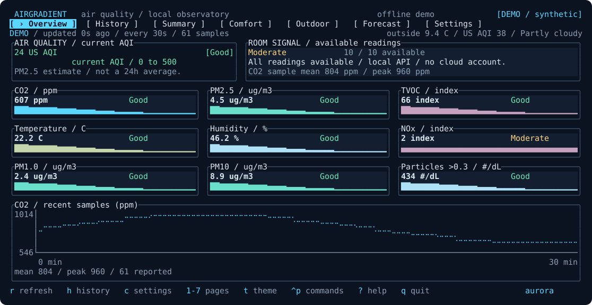
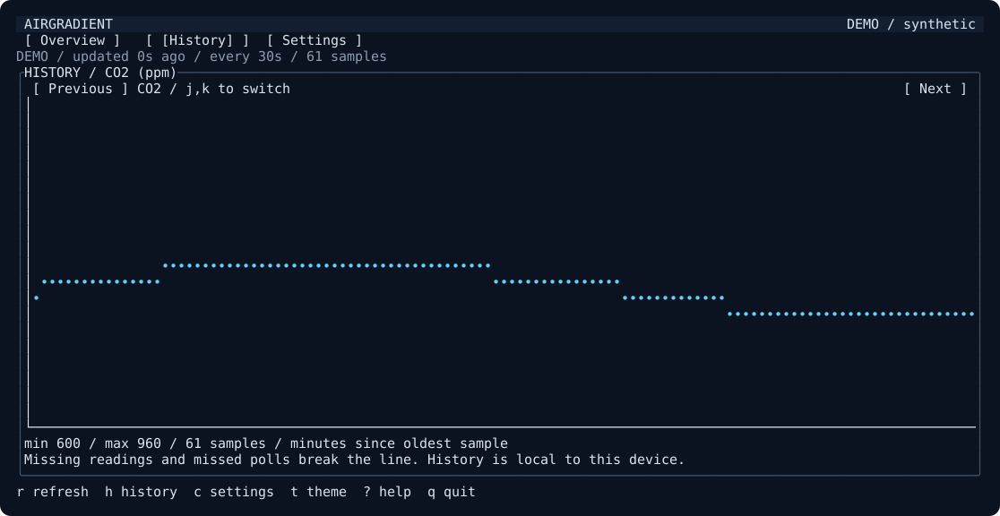
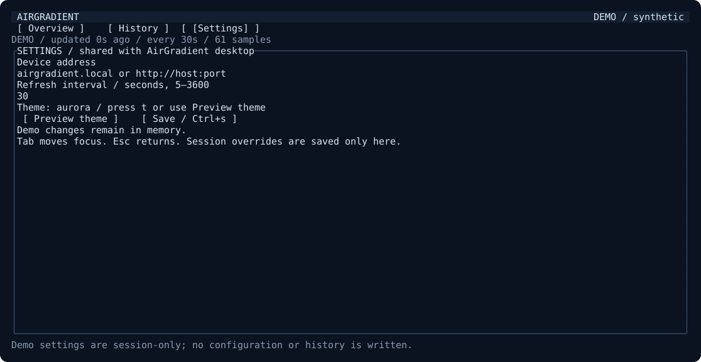
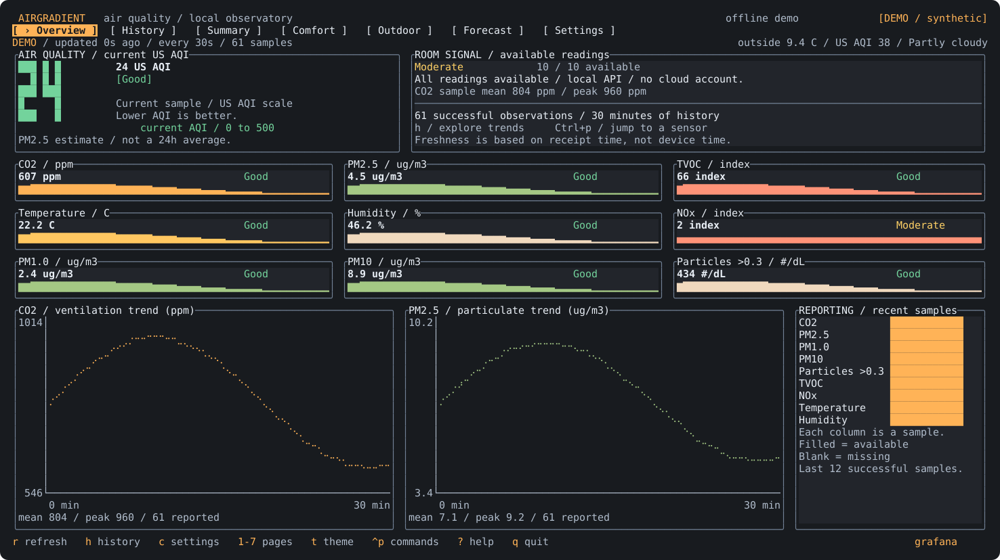
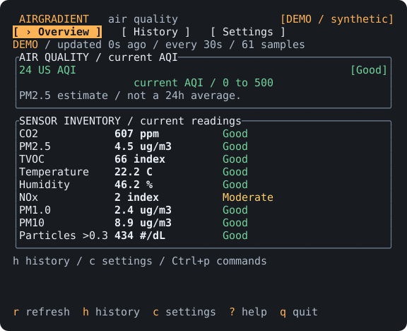

<div align="center">


# AirGradient TUI

### Your air. Your terminal. A little more ✨ clarity.

A local air-quality dashboard for people who live in the terminal.<br>
Built with **Scala 3** + **[Glyphora](https://github.com/worxbend/glyphora)**. Powered by your AirGradient monitor.

[](https://github.com/worxbend/airgradient-tui-scala/actions/workflows/ci.yml)
[](build.mill)
[](https://github.com/worxbend/glyphora)
[](https://github.com/worxbend/airgradient-tui-scala/releases/latest)
[](LICENSE)

**[🌐 Microsite](https://worxbend.github.io/airgradient-tui-scala/)** ·
**[📦 Download](https://github.com/worxbend/airgradient-tui-scala/releases/latest)** ·
**[🚀 Quick start](#-quick-start)** ·
**[⌨️ Controls](#-make-yourself-at-home)** ·
**[🛠️ Contribute](#-build--contribute)**

<br>



<sub>Actual Glyphora renderer · Synthetic demo data · No hardware readings</sub>

<br><br>

**📡 Direct to your monitor &nbsp; 🏡 Local history &nbsp; 🎨 15 palettes &nbsp; 🫧 Offline demo**

No cloud account. No API token. No GitHub Packages credentials.

</div>

<br>

## 🚀 Quick start

### Download for Linux amd64

Grab the native archive and `SHA256SUMS` from the **[latest release](https://github.com/worxbend/airgradient-tui-scala/releases/latest)**.
In the download directory, verify the checksum, extract the archive, and try the offline demo:

```sh
sha256sum --check SHA256SUMS
tar -xzf airgradient-tui-scala-*-linux-amd64.tar.gz
./airgradient-tui --demo
```

Native releases target **Linux x86-64 / amd64** only and do not require Java.
For other platforms, run from source with a JDK.

### Run from source

Install **JDK 25 or newer**, then:

```sh
git clone https://github.com/worxbend/airgradient-tui-scala.git
cd airgradient-tui-scala
./mill app.run --demo
```

Connect your own monitor:

```sh
./mill app.run --url airgradient.local
# Or use the device's IP address; the address above is an example.
```

With no flags, the dashboard reads the shared AirGradient desktop configuration.
Press **c** to edit the address, refresh interval, and theme. **Ctrl+s** saves.
Command-line overrides apply to the current session until you explicitly save them.
Refresh intervals are 5–3600 seconds; the default is 30.

For scripts and non-interactive sessions:

```sh
./mill app.run --url airgradient.local --once
./mill app.run --url airgradient.local --json
./mill app.run --demo --json
./mill app.run --help
```

The device is read directly at `/measures/current`, following the
[AirGradient Local API](https://www.airgradient.com/documentation/kb/where-do-i-access-the-api-documentation-api-token-and-local-api).
The dashboard needs an interactive terminal; `--once` and `--json` work in pipelines.

## ✨ A clearer view of your air

| | The good stuff |
| :---: | --- |
| 📡 | **Live readings** — AQI, CO₂, particulate measurements, TVOC/NOx indices, temperature, humidity. |
| 📈 | **History with context** — Braille time-series charts, labeled axes, sample means and peaks, and honest gaps. |
| 🎨 | **Your terminal, your palette** — 15 themes, including Grafana-inspired dark and four light palettes. |
| 🧭 | **Honest status** — stale readings show their age; missing readings stay visibly missing. |
| 🏡 | **Local by default** — direct device requests, desktop-compatible settings, per-device history. |
| 🫧 | **Try it offline** — deterministic demo; no network, config reads, or history writes. |

<details>
<summary><strong>A few thoughtful details</strong></summary>

- Live AQI, CO2, particulate measurements, TVOC and NOx indices, temperature, and humidity.
- Responsive sensor cards, dual charts and a reporting matrix on large terminals, a full inventory on compact terminals, and explicit resize guidance below 48×18.
- History charts with actual elapsed time, selectable metrics, and breaks for missing samples or missed polls.
- 15 palettes with semantic status colors; every status has a word as well as a color.
- Last-known values stay on screen after a failed refresh, marked **STALE** with their age.
- Quiet in-app notifications when readings worsen into elevated bands or recover to Good.
- Searchable commands for navigation, metrics, and named themes with <kbd>Ctrl</kbd>+<kbd>p</kbd>.
- Current, minimum, sample-mean, and peak history summaries, plus threshold-band observation counts.
- Session settings and an editor that merges changes into the shared desktop JSON.
- A deterministic demo that performs no network requests, config reads, or history writes.

</details>

## ⌨ Make yourself at home

| Key | Action |
| --- | --- |
| <kbd>r</kbd> | Refresh now |
| <kbd>h</kbd> | Switch overview / history |
| <kbd>j</kbd> / <kbd>k</kbd> | Next / previous history metric |
| <kbd>c</kbd> | Settings |
| <kbd>t</kbd> | Preview the next theme |
| <kbd>Ctrl</kbd>+<kbd>p</kbd> | Search commands, themes, and metric histories |
| <kbd>Tab</kbd> / <kbd>Shift</kbd>+<kbd>Tab</kbd> | Move between controls |
| <kbd>Ctrl</kbd>+<kbd>s</kbd> | Save settings |
| <kbd>?</kbd> | Keyboard guide |
| <kbd>Esc</kbd> | Close help, return to overview, or quit |
| <kbd>q</kbd> | Quit (outside text editing) |

Buttons also support mouse activation. The theme preview is session-only until saved.
In Settings, focus the theme chooser and press Enter to open it. Use the arrow keys
and Enter to select; Esc closes the chooser before leaving Settings.

### 🎨 Find your palette

Preview all 15 themes in the **[interactive theme gallery](https://worxbend.github.io/airgradient-tui-scala/#themes-title)**.
Every preview is captured from the actual Glyphora renderer with synthetic demo data.

| Theme | Look | Theme | Look |
| --- | --- | --- | --- |
| `aurora` | Deep navy + electric cyan | `grafana` | Graphite + warm orange |
| `nord` | Slate + arctic blue | `ocean` | Deep sea + turquoise |
| `mono` | High contrast + ASCII glyphs | `forest` | Evergreen + fresh green |
| `ember` | Warm charcoal + amber | `sunset` | Aubergine + peach |
| `lavender` | Ink violet + lilac | `rose` | Dark plum + pink |
| `cobalt` | Midnight blue + cobalt | `paper` | White + deep blue |
| `sand` | Warm ivory + terracotta | `frost` | Ice blue + teal |
| `mint` | Pale green + emerald | | |

```sh
./mill app.run --demo --theme grafana
./mill app.run --demo --theme paper
```

Press <kbd>t</kbd> to cycle through the collection. Save with <kbd>Ctrl</kbd>+<kbd>s</kbd>
in Settings to keep a theme. CLI overrides and previews stay session-only until saved;
demo mode never writes your configuration.

<details>
<summary><strong>📈 A peek at history</strong></summary>



Synthetic data captured from the actual Glyphora renderer.

</details>

<details>
<summary><strong>⚙️ A peek at settings</strong></summary>



Synthetic demo configuration captured from the actual Glyphora renderer.

</details>

<details>
<summary><strong>🖥️ A wider workspace</strong></summary>



Grafana-inspired palette at 160×44. Every reporting-matrix column represents a successful sample;
filled cells mean the sensor supplied a reading, and blank cells mean it did not.

</details>

<details>
<summary><strong>⌨ A compact workspace</strong></summary>



The full inventory stays available at 60×24, with a smaller layout down to 48×18.

</details>

## 🏡 Your data stays local

**Configuration:** `$XDG_CONFIG_HOME/airgradient-desktop/config.json`, falling back to
`~/.config/airgradient-desktop/config.json`. Compatible keys are `server_url`,
`refresh_interval_secs`, and `theme`. Unfamiliar desktop fields survive updates.
An unknown saved theme falls back to Aurora. Invalid refresh settings produce a visible warning.
Malformed JSON is reported and is never silently overwritten.

Config saves use an atomic replacement and a content fingerprint to reject edits made
since the editor opened. Other AirGradient clients do not share a lock, so a very narrow
check-to-rename race remains. This is conflict detection, not a cross-client transaction.

**History:** `$XDG_DATA_HOME/airgradient-tui-scala/history.jsonl`, falling back to
`~/.local/share/airgradient-tui-scala/history.jsonl`. Up to 2000 successful samples are
retained across device sessions; charts filter by the normalized device address.
The Rust CLI's history file is kept separate. Timestamps represent receipt time.
Malformed or truncated records are skipped. History errors stay visible without losing the live reading.

```sh
# Isolated settings and history
./mill app.run --config ./my-config.json --history ./my-history.jsonl

# Read existing history but do not record new samples
./mill app.run --no-history
# Equivalent: AIRGRADIENT_TUI_NO_HISTORY=1
```

The parser follows [airgradient-cli](https://github.com/worxbend/airgradient-cli):
numeric strings and nested aliases, compensated temperature/humidity, the monitor's
particulate compensation switch, bounded sensor values, and explicit AQI before PM2.5-derived AQI.
Missing values are `--` in the UI and `null` in JSON. TVOC/NOx values are indices.
The displayed PM2.5-derived AQI is an estimate from the current sample, not a 24-hour exposure average.
History means are arithmetic means of reported samples, not time-weighted exposure averages.
Card sparklines show relative variation within each metric's recent sample window;
their heights are not comparable across cards. Below-zero readings remain visible and use the signed history chart.
Chart axes adapt to observed values and include bounds; missing readings and missed polls break the line.
See [architecture and contracts](docs/architecture.md).

## 🧩 A real Glyphora consumer

```scala
def mvnDeps = Seq(
  mvn"com.worxbend::tui-dsl:0.18.3",
  mvn"com.lihaoyi::ujson:4.4.3",
)
```

The build resolves released artifacts from public Maven Central. There is no sibling
checkout, Git submodule, copied toolkit source, or local publish step.
`tui-test` is a test-only dependency.

The application demonstrates Glyphora signals, owned async task scopes, lifecycle hooks,
responsive layouts, themed metric cards, gauges, sparklines, charts, inputs, buttons,
keyboard bindings, notifications, and headless Pilot tests.

## 🛠 Build & contribute

Bug reports, fixes, and ideas are welcome. [Open an issue](https://github.com/worxbend/airgradient-tui-scala/issues)
with your platform, Java version, steps to reproduce, and a sanitized example when useful.
Keep device addresses, serial numbers, credentials, and home readings out of contributions.
For code changes, follow [AGENTS.md](AGENTS.md) and [architecture and contracts](docs/architecture.md),
then run the relevant checks below before opening a pull request.

Pins: Mill **1.1.9**, Scala **3.9.0**, Glyphora **0.18.3**, uJSON **4.4.3**,
ScalaTest **3.2.20**, GraalVM CE **25.0.2**. Mill's build process defaults to Temurin 25.

```sh
./mill app.test
python3 -m pip install --requirement scripts/requirements.txt
./mill mill.scalalib.scalafmt.ScalafmtModule/checkFormatAll __.sources
python3 scripts/verify-dependencies.py
python3 scripts/check-snapshots.py

# JVM distribution
python3 scripts/package.py
java --enable-native-access=ALL-UNNAMED -jar dist/airgradient-tui.jar --demo
python3 scripts/smoke-pty.py --jar dist/airgradient-tui.jar
python3 scripts/smoke-http.py --jar dist/airgradient-tui.jar

# Native executable on the current platform
python3 scripts/package.py --native
./dist/airgradient-tui --demo
python3 scripts/smoke-pty.py --binary dist/airgradient-tui
python3 scripts/smoke-http.py --binary dist/airgradient-tui
```

CI runs the test suite and packaged JAR on JDK 25 and 26, checks published dependency
resolution and screenshot reproducibility, then builds and exercises a Linux amd64
native executable. Runnable artifacts and SHA256 checksums are attached to successful CI runs.
Native builds target GraalVM's compatibility CPU baseline rather than the builder's newer instruction set.
Release tags matching `Main.Version` publish the validated **Linux amd64 native archive and SHA256 checksums**.
Every release uses a new tag; existing tags are never moved.

The network tests use a local mock HTTP server. Terminal lifecycle tests use real
pseudo-terminals and check that terminal settings are restored. Live AirGradient
hardware has not been tested for this application.

Regenerate screenshots after intentional UI changes:

```sh
python3 scripts/capture-snapshots.py
```

### Microsite

The [project microsite](https://worxbend.github.io/airgradient-tui-scala/) lives in [`site/`](site/).
It uses plain HTML, CSS, and JavaScript. The Python staging script builds the theme picker
from the renderer's theme manifest; no frontend package installation is needed.
Preview the same files that GitHub Pages deploys:

```sh
python3 scripts/build-site.py
python3 -m http.server 8080 --directory dist/site
```

Changes to the site or renderer assets deploy from `main` through [the Pages workflow](.github/workflows/pages.yml).

## 💚 Credits

Device contracts and interaction references:
[worxbend/airgradient-cli](https://github.com/worxbend/airgradient-cli).
The synthetic firmware fixtures are adapted from that MIT-licensed project.
UI and testing: [Glyphora](https://github.com/worxbend/glyphora).
JSON parsing: [uJSON](https://com-lihaoyi.github.io/upickle/).

<div align="center">

<br>

**Made for a little more breathing room. 🫧**

[MIT license](LICENSE) · [GitHub](https://github.com/worxbend/airgradient-tui-scala) · [Microsite](https://worxbend.github.io/airgradient-tui-scala/)

<sub>An independent community project. Not an official AirGradient product.</sub>

</div>
