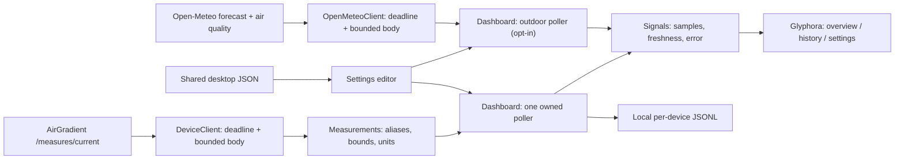

# Architecture and contracts

This is an application built against Glyphora's published API. The build consumes
`com.worxbend::tui-dsl:0.20.0` and a test-only `tui-test` from Maven Central.

- **Model.scala** owns optional normalized measurements, display units, threshold bands, and the reference CLI's alias precedence.
- **DeviceClient.scala** owns URL normalization, HTTP, a five-second whole-response deadline, the one-MiB streaming limit, and request cancellation. Redirects are reported rather than followed.
- **Persistence.scala** owns shared-config merges, content fingerprints, atomic replacements, and a separate bounded history store.
- **Dashboard.scala** owns reactive state and lifecycle. A task scope is created on the render owner in `onStart`; timer and request callbacks return to that owner.
- **Telemetry.scala** derives pure, per-metric sample summaries and gap-aware chart segments. A long-lived Glyphora `Computed` caches these until readings or the refresh interval change, rather than recomputing on age ticks. The dashboard disposes it on shutdown. Missing readings never become zeroes; last-sample deltas are withheld across missing readings or missed polls. Means describe reported samples rather than time-weighted exposure.
- **Palettes.scala** holds 15 semantic palettes, including a Grafana-inspired dark palette and four light palettes. The catalog supplies CLI validation, settings persistence, keyboard cycling, and renderer previews. Views ask for status styles instead of embedding ANSI color codes. New palettes keep semantic text at a contrast ratio of at least 4.5:1 on their base and raised surfaces, and borders at least 3:1. Focus and loading styles derive from the same palette.
- **Outdoor.scala** owns locations, Open-Meteo request building and parsing, outdoor bands (US AQI, European AQI pollutant bands, UV), WMO weather descriptions, and the synthetic demo client. Forecast hours keep the location's own wall-clock labels, so captures do not depend on the machine's time zone.
- Pollen (alder, birch, grass, mugwort, olive, ragweed) comes from the CAMS European model; outside Europe the values are null and shown as unavailable. Pollen bands are approximate and species-agnostic. The daily outlook (three days) carries highs, lows, rain chance, UV peak, and sunrise/sunset in the location's calendar.
- **Comfort.scala** holds pure derived metrics (dew point, absolute humidity, heat index, mold and condensation risk, CO2 trend) and the window-advice rules that compare indoor and outdoor air.
- **Main.scala** owns command parsing, session overrides, one-shot output, startup, and exit codes.

Only one request is in flight per polling session. Changing settings retires the old scope,
cancels its HTTP request, and increments a generation number. Old results cannot replace
the new session's state. Quitting closes scopes and the HTTP client. Disk and network
work run off the render thread. Glyphora scope cancellation suppresses pending callbacks;
HTTP cancellation and deadlines bound the underlying IO.

Outdoor data has its own owned task scope, created only when a location exists. It polls every
15 minutes, throttles manual refreshes to one per 30 seconds, and carries a generation number like the
device poller. Changing the location retires the scope and cancels in-flight requests. A failed refresh
keeps the last report on screen, marked STALE. Weather and air are fetched separately; one failing half
still yields a report with a visible warning. Geocoding a typed place name runs in the save task, off
the render thread. Demo mode always uses the synthetic client. Heads-up alerts look 12 hours ahead;
the first report after start or a location change only sets a baseline, so notifications announce
new events rather than repeating what the Forecast page already shows.

Successful samples alone enter history. Failed requests preserve the last sample and its
receipt time. A stored sample is never reported as a newly successful request. Charts use
receipt times and split datasets at missing values or gaps longer than 1.5 refresh intervals.
Sparklines show a gap label instead of plotting missing readings as zero.

Snapshot parsing tries direct aliases before nested objects. Keys are case-insensitive and
ignore separators while preserving numeric runs: `pm02` does not become `pm2`.
Compensated temperature and humidity fall back to raw values if invalid. Compensated
particulates follow `monitorDisplayCompensatedValues`, defaulting to compensated values
when that switch is absent. An explicit valid AQI wins over PM2.5-derived AQI.
TVOC and NOx use the reference client's index aliases and index units; raw sensor signals
are not mislabeled as concentration.

Thresholds and AQI interpolation follow the current Rust CLI reference, including its
PM1 classification using the PM2.5 scale. This application does not claim a complete
EPA exposure calculation. Values are current device observations.

Config fingerprint checks detect ordinary concurrent changes but cannot eliminate a race
with clients that do not participate in locking. History files belong to this application;
the Rust CLI's history is neither imported nor modified.

The presentation uses Glyphora responsive layouts, semantic badges and surfaces, gauges,
sparklines, labeled Braille charts (cell markers in ASCII mode), a reporting heatmap,
interactive dropdowns, command search, tables, buttons, notices, scoped notifications, and help overlays.
Metric series accents derive from palette colors. Card sparklines normalize each recent
window independently; signed measurements use the history chart rather than being clamped to zero.
The reporting matrix describes presence or absence of values in successful samples;
it does not imply that failed polls produced observations. The compact inventory retains
all metrics at 48×18, and the wide layout exposes dual charts at 140 columns and above.

Testing covers parser fixtures, boundaries and missing values; real HTTP error paths;
config preservation/conflicts; history retention; reactive UI transitions and resize;
deterministic actual-renderer captures; and packaged applications in real pseudo-terminals.
Theme tests also cover contrast, complete preview cycling and wraparound, offline demo behavior,
and saving every palette without discarding other clients' fields. Interaction tests cover
named commands, dropdown mouse/keyboard handling and Escape precedence, and all readings at six terminal sizes.
Screenshot verification checks every theme's actual dashboard capture and the gallery manifest,
alongside all three screens, wide/compact/minimal layouts, help, command search, and the theme chooser.
These checks establish software behavior with synthetic devices, not physical sensor accuracy.
