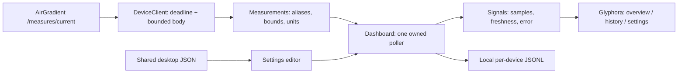

# Architecture and contracts

This is an application built against Glyphora's published API. The build consumes
`com.worxbend::tui-dsl:0.18.3` and a test-only `tui-test` from Maven Central.

- **Model.scala** owns optional normalized measurements, display units, threshold bands, and the reference CLI's alias precedence.
- **DeviceClient.scala** owns URL normalization, HTTP, a five-second whole-response deadline, the one-MiB streaming limit, and request cancellation. Redirects are reported rather than followed.
- **Persistence.scala** owns shared-config merges, content fingerprints, atomic replacements, and a separate bounded history store.
- **Dashboard.scala** owns reactive state and lifecycle. A task scope is created on the render owner in `onStart`; timer and request callbacks return to that owner.
- **Palettes.scala** holds semantic colors. Views ask for status styles instead of embedding ANSI color codes.
- **Main.scala** owns command parsing, session overrides, one-shot output, startup, and exit codes.

Only one request is in flight per polling session. Changing settings retires the old scope,
cancels its HTTP request, and increments a generation number. Old results cannot replace
the new session's state. Quitting closes scopes and the HTTP client. Disk and network
work run off the render thread. Glyphora scope cancellation suppresses pending callbacks;
HTTP cancellation and deadlines bound the underlying IO.

Successful samples alone enter history. Failed requests preserve the last sample and its
receipt time. A stored sample is never reported as a newly successful request. Charts use
receipt times and split datasets at missing values or gaps longer than 1.5 refresh intervals.
Sparklines show a gap label instead of plotting missing readings as zero.

Snapshot parsing tries direct aliases before nested objects. Keys are case-insensitive and
ignore separators while preserving numeric runs: `pm02` does not become `pm2`.
Compensated temperature and humidity fall back to raw values if invalid. Compensated
particulates follow `monitorDisplayCompensatedValues`, defaulting to compensated values
when that switch is absent. An explicit valid AQI wins over PM2.5-derived AQI.
TVOC and NOx use the reference client's index aliases and index units; raw sensor signals
are not mislabeled as concentration.

Thresholds and AQI interpolation follow the current Rust CLI reference, including its
PM1 classification using the PM2.5 scale. This application does not claim a complete
EPA exposure calculation. Values are current device observations.

Config fingerprint checks detect ordinary concurrent changes but cannot eliminate a race
with clients that do not participate in locking. History files belong to this application;
the Rust CLI's history is neither imported nor modified.

Testing covers parser fixtures, boundaries and missing values; real HTTP error paths;
config preservation/conflicts; history retention; reactive UI transitions and resize;
deterministic actual-renderer captures; and packaged applications in real pseudo-terminals.
These checks establish software behavior with synthetic devices, not physical sensor accuracy.
